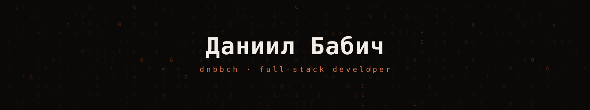

  

Полный стек — Python/Django и FastAPI на бэке, React и Next.js на фронте,
Swift для iOS/macOS, интеграции LLM. Делаю продукты целиком: от идеи и
архитектуры до прода.

### Проекты

| Проект | Что это | Стек |
|---|---|---|
| [astrocoins.ru](https://astrocoins.ru) | EdTech-платформа с геймификацией обучения | Django · React |
| [domikarshan.ru](https://domikarshan.ru) | Бронирование гостевых домов Бурятии | Django · React |
| [voxara.cards](https://voxara.cards) | IELTS-коуч с интервальным повторением (SM-2) | Next.js · TypeScript |
| [kontentforge.ru](https://kontentforge.ru) | SaaS для контент-планов с AI-генерацией | FastAPI · React |
| [yishu.su](https://yishu.su) | Мультиязычный бренд-сайт (RU/EN/ZH) | Next.js |
| [myprosport.ru](https://myprosport.ru) | Платформа спортивных мероприятий | Django |
| [linotype](https://github.com/dnbbch/linotype) | Нейросетевой переключатель раскладки macOS | Swift · CoreML |
| ember | Голосовой AI-ассистент (iOS/macOS) | Swift · LLM |
| Telegram-боты | Боты и интеграции для вуза: расписание, уведомления | Python · aiogram |
