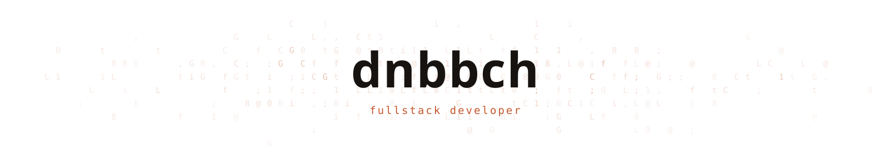

  <picture>
  <source media="(prefers-color-scheme: dark)" srcset="./banner-dark.svg" />
  
</picture>

Полный стек — Python/Django и FastAPI на бэке, React и Next.js на фронте,
Swift для iOS/macOS, интеграции LLM. Делаю продукты целиком: от идеи и
архитектуры до прода.

  &nbsp;&nbsp;
  &nbsp;&nbsp;
  &nbsp;&nbsp;
  &nbsp;&nbsp;
  &nbsp;&nbsp;
  &nbsp;&nbsp;
  &nbsp;&nbsp;
  &nbsp;&nbsp;
  &nbsp;&nbsp;
  &nbsp;&nbsp;
  &nbsp;&nbsp;
  

<table align="center">
  <tr><th>Проект</th><th>Что это</th><th>Стек</th></tr>
  <tr><td><a href="https://domikarshan.ru">domikarshan.ru</a></td><td>Туризм · Платформа бронирования</td><td>React · TypeScript · Vite · Tailwind CSS</td></tr>
  <tr><td><a href="https://astrocoins.ru">astrocoins.ru</a></td><td>Образование · Система геймификации</td><td>Python · Django · MySQL · JavaScript · Claude</td></tr>
  <tr><td><a href="https://yishu.su">yishu.su</a></td><td>E-commerce · Многоязычный лендинг бренда</td><td>Next.js · TypeScript · Tailwind CSS</td></tr>
  <tr><td>kontentforge.ru</td><td>SaaS · ИИ-автоматизация контента</td><td>Python · FastAPI · React · TypeScript · Tailwind CSS</td></tr>
  <tr><td>ember</td><td>iOS/macOS · Голосовое ИИ-приложение</td><td>Swift · OpenAI</td></tr>
  <tr><td>voxara.cards</td><td>Образование · ИИ-тренер по IELTS (PWA)</td><td>Next.js · TypeScript · Supabase · OpenAI</td></tr>
  <tr><td><a href="https://github.com/dnbbch/linotype">linotype</a></td><td>macOS · Утилита с ML на устройстве</td><td>Swift · Apple</td></tr>
  <tr><td>myprosport.ru</td><td>Спорт · Многоролевая платформа</td><td>Python · Django · MySQL</td></tr>
  <tr><td>bot.esstu.ru</td><td>Государство · Информационные боты для вуза</td><td>Python · Django · Docker · Telegram</td></tr>
</table>

